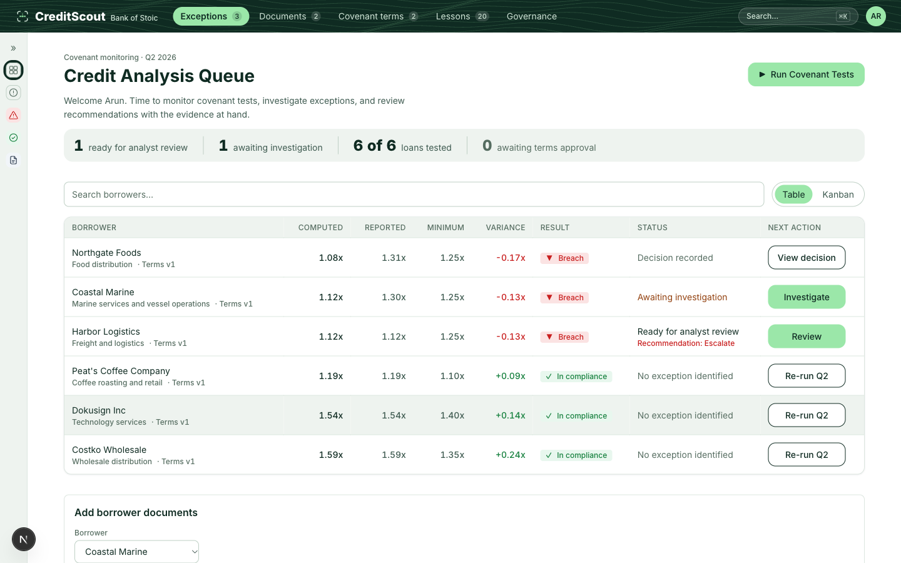
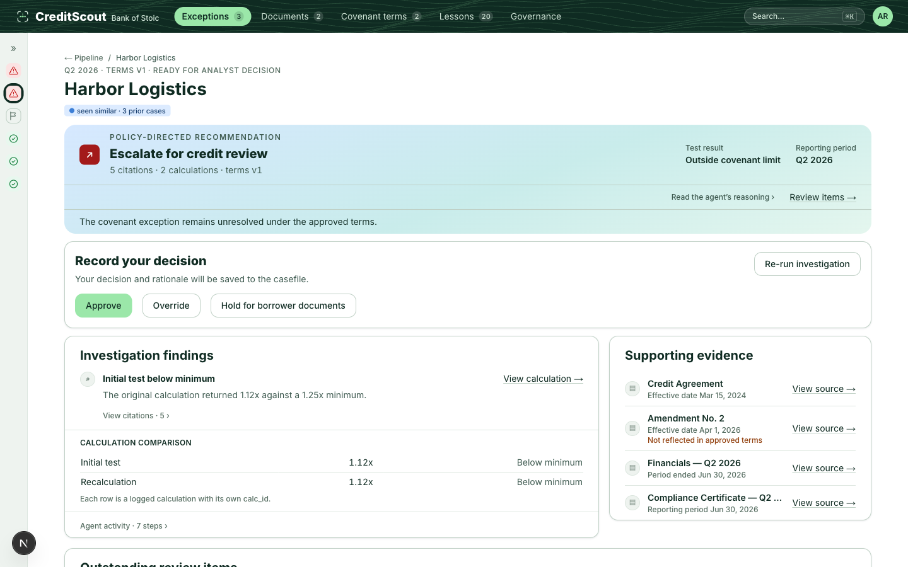

# CreditScout

**A reasoning layer decides what to check next. A calculation layer never guesses. A human always approves.**

CreditScout is an AI assistant for commercial credit analysts who monitor loan covenants every quarter. When a borrower's reported DSCR (debt service coverage ratio) misses its contractual minimum, CreditScout investigates the exception the way an analyst would, reading the loan agreement, its amendments, and the borrower's financials, and hands back a recommendation with every number traced to a citation or a calculation. The analyst always decides.

**Live demo:** `https://credit-scout.vercel.app` (demo credentials shown on the sign-in screen)



## The idea that settles most design questions

> The model never produces a number. Every figure in an explanation must trace to a logged calculation or a verbatim quote from a cited document, or the guardrail forces the recommendation to abstain.

Most "AI for lending" tools either let a model freehand a number (fast, unauditable) or hard-code a rules engine (auditable, can't investigate). CreditScout splits the job instead:

- **The agent reasons.** An orchestrator decides what evidence to pull next: the credit agreement, an amendment, a borrower's compliance certificate, and when to call the deterministic calculator.
- **The code calculates.** `calc/dscr.js` and `guardrails/*.js` are zero-dependency, import-free, and the only place a number is ever produced. They round the same way every time, and a missing input is an error, never a silent zero.
- **A guardrail enforces honesty.** If a number in the agent's explanation doesn't trace to a logged `calc_id` or a verbatim quote the code itself verified against the source document, the recommendation is forced to `abstain`, not a plausible-sounding guess.
- **A human always approves.** The agent's output is a recommendation, never a decision. Every casefile ends at an analyst clicking Approve, Override, or Hold for borrower documents.

## What it looks like



- **A risk-sorted queue, not a worklist.** The home screen is a dense table sorted by how far a loan is from its covenant minimum, not by when it was touched last, with the same five status filters available as a toggleable kanban board.
- **Every recommendation shows its basis.** Citations, calculations, the terms version it ran against, and when a code guardrail overrode the agent's own answer, the screen says so plainly rather than attributing a policy-enforced outcome to the agent.
- **Nothing is retained that isn't indexed.** An uploaded document's preview is reconstructed from its own indexed chunks, in the order they were extracted, the same ones the agent cites from, not a cached copy of the file.

## How it's built

| Layer | What |
|---|---|
| Orchestration | Azure AI Foundry Agent Service, one orchestrator agent (`gpt-4.1-mini`) with six function tools: three HTTP routes and three specialists serviced in-process |
| App | Next.js App Router on Vercel, the analyst UI, the analyst API, and the OpenAPI tool routes the agent itself calls |
| Data | Supabase (Postgres + pgvector) for loans, documents, calculations, and the agent's own memory of past cases |
| Calculation | Hand-written, zero-dependency, unit-tested, `node:test` only, no framework |
| Evaluation | A signed oracle (owner-approved expected values) and an eval harness that scores every run Honest / Harmless / Helpful, not just "did it run" |

Six seeded loans carry the demo: three with a deliberate covenant twist (a boarded-but-unreflected amendment, a true breach, a reporting discrepancy) and three performing normally, so the book isn't made entirely of exceptions. Every document is synthetic and marked as such; no real borrower data exists in this project.

## Why this exists

Covenant monitoring is 20–30% of a credit analyst's time, roughly 4 hours per loan per quarter, almost all of it spent re-deriving a number that should already be known and chasing down which amendment actually governs the current test. The investigation after a flag can't be written as a rules engine: the answer lives across a 60-page agreement, its amendments, and a borrower-prepared certificate, and which one controls depends on effective dates a rules engine doesn't reason about. The full product thinking (hypothesis, success metrics, rollout gates, and the business case) is in [`docs/prd-onepager.md`](docs/prd-onepager.md).

## Project docs

| | |
|---|---|
| Current state & handoff | [`docs/HANDOFF.md`](docs/HANDOFF.md) |
| Product spec (full PRD) | [`docs/prd.md`](docs/prd.md) · one-pager: [`docs/prd-onepager.md`](docs/prd-onepager.md) |
| Architecture & build sequence | [`docs/engineering/engineering-doc.md`](docs/engineering/engineering-doc.md) |
| Design system | [`docs/design.md`](docs/design.md) |
| User flows & screen inventory | [`docs/mental-model.md`](docs/mental-model.md) |
| Everything deliberately deferred, with reasons | [`docs/parking-lot.md`](docs/parking-lot.md) |

## Running it locally

```bash
npm install
cp .env.example .env   # fill in Supabase + Azure AI Foundry credentials
npm run dev
```

`npm test` runs the full suite (`node:test`, no framework) against the calculation and guardrail layers plus every pure-function model in the UI. `npm run eval` runs the deterministic eval harness for free; `npm run eval -- --live` runs it against the real agent (billable).

---

*Built end-to-end (product spec, architecture, implementation, and UI) in an agentic development workflow with Claude Code.*
