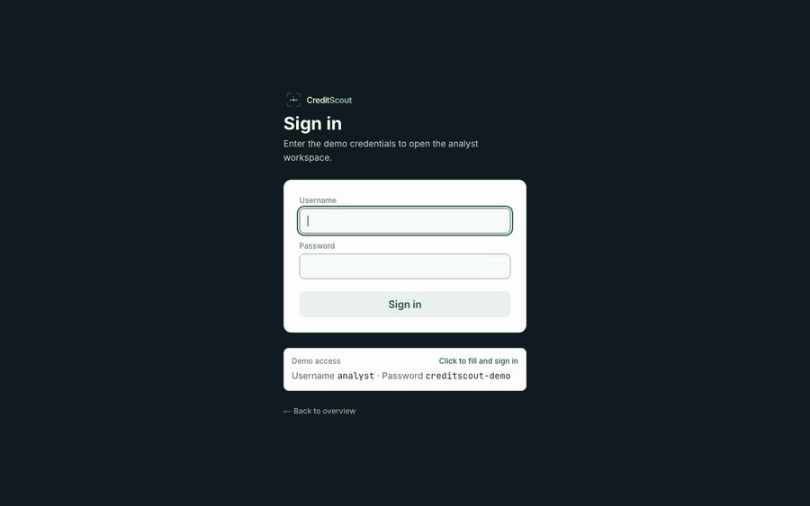
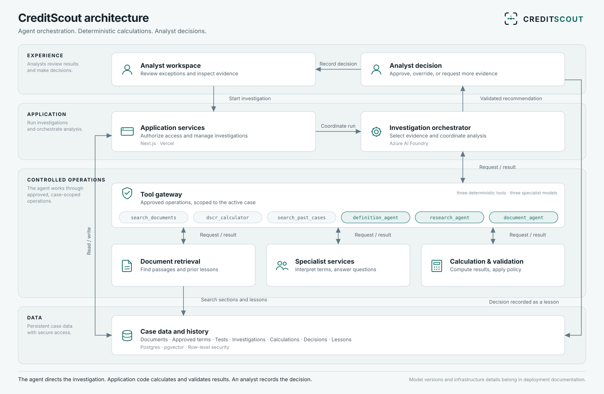

# CreditScout

[](https://github.com/arunr-mib/creditscout/actions/workflows/ci.yml)

**A reasoning layer decides what to check next. A calculation layer never guesses. A human always approves.**

CreditScout is an AI assistant for commercial credit analysts who monitor loan covenants every quarter. When a borrower's reported DSCR (debt service coverage ratio) misses its contractual minimum, CreditScout investigates the exception the way an analyst would, reading the loan agreement, its amendments, and the borrower's financials, and hands back a recommendation with every number traced to a citation or a calculation. The analyst always decides.

**Live demo:** `https://credit-scout.vercel.app` (demo credentials shown on the sign-in screen)

<p align="center">
  
</p>

<sub>Silent 80-second walkthrough of the analyst UI (synthetic data). Full-resolution video: [creditscout-demo.mp4](docs/demo/creditscout-demo.mp4).</sub>




## The idea that settles most design questions

> The model never produces a number. Every figure in an explanation must trace to a logged calculation or a verbatim quote from a cited document, or the guardrail forces the recommendation to abstain.

Most "AI for lending" tools either let a model freehand a number (fast, unauditable) or hard-code a rules engine (auditable, can't investigate). CreditScout splits the job instead:

- **The agent reasons.** An orchestrator decides what evidence to pull next: the credit agreement, an amendment, a borrower's compliance certificate, and when to call the deterministic calculator.
- **The code calculates.** `calc/dscr.js` and `guardrails/*.js` are zero-dependency, import-free, and the only place a number is ever produced. They round the same way every time, and a missing input is an error, never a silent zero.
- **A guardrail enforces honesty.** If a number in the agent's explanation doesn't trace to a logged `calc_id` or a verbatim quote the code itself verified against the source document, the recommendation is forced to `abstain`, not a plausible-sounding guess.
- **A human always approves.** The agent's output is a recommendation, never a decision. Every casefile ends at an analyst clicking Approve, Override, or Hold for borrower documents.

## What it looks like


- **A risk-sorted queue, not a worklist.** The home screen is a dense table sorted by how far a loan is from its covenant minimum, not by when it was touched last, with the same five status filters available as a toggleable kanban board.
- **Every recommendation shows its basis.** Citations, calculations, the terms version it ran against, and when a code guardrail overrode the agent's own answer, the screen says so plainly rather than attributing a policy-enforced outcome to the agent.
- **Nothing is retained that isn't indexed.** An uploaded document's preview is reconstructed from its own indexed chunks, in the order they were extracted, the same ones the agent cites from, not a cached copy of the file.

## How it's built

| Layer | What |
|---|---|
| Orchestration | Azure AI Foundry Agent Service, one orchestrator agent (`gpt-4.1-mini`) with six function tools: three HTTP routes and three specialists serviced in-process |
| App | Next.js App Router on Vercel, the analyst UI, the analyst API, and the OpenAPI tool routes the agent itself calls |
| Data | Supabase (Postgres + pgvector) for loans, documents, calculations, and the agent's own memory of past cases |
| Calculation | Hand-written, zero-dependency, unit-tested, `node:test` only, no framework |
| Evaluation | A signed oracle (owner-approved expected values) and an eval harness that scores every run Honest / Harmless / Helpful, not just "did it run" |

Six seeded loans carry the demo: three with a deliberate covenant twist and three performing normally, so the book isn't made entirely of exceptions. Two of the twists (Harbor Logistics, and Coastal Marine in Q2 2026) are an amendment that is on file but not yet boarded into the approved terms; the third (Northgate Foods) is a true breach behind a borrower certificate that reports compliance. Coastal Marine also carries a quarter where the borrower takes more of a capped add-back than the agreement allows, but both figures clear the minimum, so the variance is logged, not investigated. Every document is synthetic and marked as such; no real borrower data exists in this project.

## Measured results

Live eval, 2026-11-13, code at commit `46f368c` (includes the `chunksForCalcProvenance` provenance fix). Orchestrator `gpt-4.1-mini`, specialists `gpt-5-mini`. Run ids `eval-20261113T161940Z-cold` and `eval-20261113T162519Z-warm`. The cold pass has no past decisions to draw on; the warm pass reviews each case before the next, so later cases can retrieve earlier lessons.

| Metric | Target | Cold | Warm |
|---|---|---|---|
| False resolves (hard gate) | 0 | **0** | **0** |
| Calculation accuracy | 100% | **100%** (12/12 signed figures) | **100%** (12/12) |
| Outcome accuracy | ≥ 85% | **60%** (3/5), miss | **80%** (4/5), miss |
| Avg steps per agent investigation | visible reduction warm vs cold | 8.7 | 7.3 |
| Citation hit rate | ≥ 90% | not measured | not measured |
| Correct abstain / request | ≥ 90% | not measured | not measured |
| Groundedness (LLM judge) | reported | not measured | not measured |
| Cases counted | | 5 of 10 | 5 of 10 |

Of the 10 owner-signed cases, 5 count per pass: 3 investigated by the agent, 2 decided by code alone. The other 5 are onboarding borrowers that are not in the database yet, so they are skipped.

**Outcome accuracy misses its 85% target in both passes, and every miss was cautious.** Cold: Harbor Logistics escalated and Coastal Marine abstained at the 12-step cap where the key says resolve. Warm: Harbor Logistics abstained where the key says resolve. No loan in breach was waved through.

**Why it missed** (from the stored casefile traces):

- Harbor Logistics, both passes: the agent passed the amendment's $500,000 cap as the restructuring amount instead of the $620,000 the financials state. The calculator refused, because it takes the document's figure and applies the cap itself. Cold fell back to 1.12 and escalated; warm answered resolve citing a calc_id never logged for the case and figures it could not trace, and the guardrail replaced it with abstain.
- Coastal Marine, cold: the agent sent figures that did not match the Q2 2026 financials, then Q1 2026 figures; the calculator refused both, and the first valid calculation came at step 11, so the 12-step cap forced abstain.
- In the earlier same-day cold pass (Harbor, 1.28) and the warm pass (Coastal, 1.30) the agent passed the right figures and reached the signed answers, so the misses are model tool-input errors that vary run to run. The calculator and guardrail turned each one into a cautious outcome, not a false resolve. Planned fixes: clearer refusal message and tool description, no repeated identical refused calls, period-filtered financials retrieval, then re-measure.

**Memory:** in this run warm beat cold on outcome accuracy (80% vs 60%) and average steps (7.3 vs 8.7). That is one run on five cases, and earlier runs were mixed (an October run scored 60% in both passes, with 7.0 steps cold vs 8.0 warm), so the effect is not established.

**This is a smoke test, not a benchmark.** Earlier the same day, a first cold pass on identical input scored 5/5 (avg 6.3 steps) before its warm pass was lost to a network failure, and the October runs swung between 60% and 100% cold. With five cases, one case is 20 points, and run-to-run variance is larger than any cold/warm difference. The path to a real benchmark:

- onboard the five skipped borrowers so all ten signed cases count;
- grow the signed set to 100+ cases;
- repeat each case several times and report a range;
- add the LLM-judged groundedness score.

## Why this exists

Covenant monitoring is 20 to 30% of a credit analyst's time, roughly 4 hours per loan per quarter, almost all of it spent re-deriving a number that should already be known and chasing down which amendment actually governs the current test. The investigation after a flag can't be written as a rules engine: the answer lives across a 60-page agreement, its amendments, and a borrower-prepared certificate, and which one controls depends on effective dates a rules engine doesn't reason about. The full product thinking (hypothesis, success metrics, rollout gates, and the business case) is in [`docs/prd-onepager.md`](docs/prd-onepager.md).

## What analysts said

Nothing yet. Conversations with working credit analysts are planned and have not happened. The problem framing above comes from market data and practitioner experience, not user research, and nothing here quotes or paraphrases an analyst.

## Project docs

- [Case study](docs/case-study.md): the design decisions, the guardrail bug that almost shipped, and the measured results.
- [Product one-pager](docs/prd-onepager.md): hypothesis, success metrics, rollout gates, and the business case.

<details><summary>Full docs</summary>

| | |
|---|---|
| Current state & handoff | [`docs/HANDOFF.md`](docs/HANDOFF.md) |
| Product spec (full PRD) | [`docs/prd.md`](docs/prd.md) |
| Architecture & build sequence | [`docs/engineering/engineering-doc.md`](docs/engineering/engineering-doc.md) |
| Design system | [`docs/design.md`](docs/design.md) |
| User flows & screen inventory | [`docs/mental-model.md`](docs/mental-model.md) |
| Everything deliberately deferred, with reasons | [`docs/parking-lot.md`](docs/parking-lot.md) |

</details>

## Running it locally

```bash
npm install
cp .env.example .env   # fill in Supabase + Azure AI Foundry credentials
npm run dev
```

`npm test` runs the full suite (`node:test`, no framework) against the calculation and guardrail layers plus every pure-function model in the UI. `npm run eval` runs the deterministic eval harness for free; `npm run eval -- --live` runs it against the real agent (billable). CI runs `npm test` and the deterministic `npm run eval` on every push to `main` and every pull request; the live eval never runs in CI.

---

*Built end-to-end (product spec, architecture, implementation, and UI) in an agentic development workflow with Claude Code. MIT licensed, see [LICENSE](LICENSE).*
